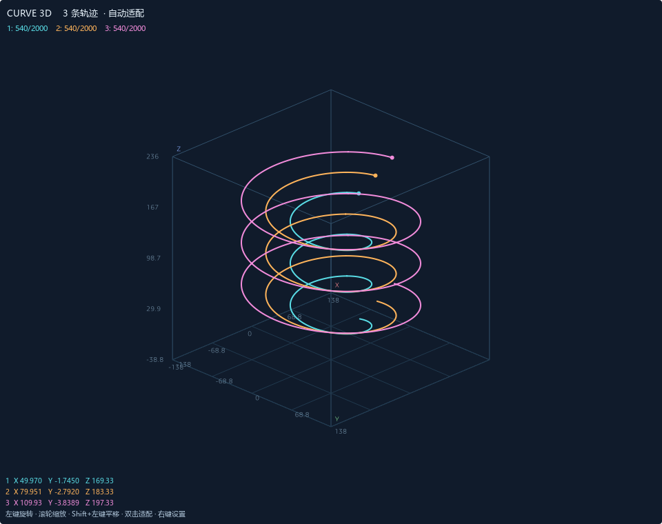

# Curve3D：Vodka / VOFA+ 三维空间曲线插件

在同一坐标系中同时显示 **1、2 或 3 条三维轨迹**。每条轨迹单独绑定一组 X、Y、Z 通道，按宿主界面刷新顺序连接成曲线；青色、橙色、粉色分别对应轨迹 1、2、3。插件使用 VOFA+ 原有的 QML 控件接口，通信仍由上位机现有的串口、UDP、TCP 等接口和协议引擎处理，无需更换数据协议或编译 DLL。



## 项目背景

Vodka 于 2020 年改名为 VOFA+。[GitHub 仓库](https://github.com/je00/Vodka) 与 [Gitee 镜像](https://gitee.com/gutega/Vodka) 开放的是数据协议引擎、控件和皮肤；README 明确说明主体尚未完整开源。

本插件参照仓库的 `widgets/example/example.qml`、`widgets/cube/cube.qml` 和[官方控件开发文档](https://www.vofa.plus/docs/learning/widgets/development/)实现。原来的 Cube 主要显示模型姿态，本插件显示的是随时间积累的 XYZ 坐标轨迹。

## 安装或更新插件

1. 关闭 VOFA+。
2. 找到 VOFA+ 的控件插件目录，官方开发文档使用 `plugins/widgets`。如果你的软件采用其他目录布局，以现有 `cube/cube.qml` 所在的 `widgets` 目录为准。
3. 在本仓库的 `widgets/curve3d` 目录中，将 `curve3d.qml` 与 `CurveMath.js` 一起复制到宿主的 `plugins/widgets/curve3d` 目录。安装后应为：

   ```text
   VOFA+/
   └─ plugins/
      └─ widgets/
         ├─ cube/
         │  └─ cube.qml
         └─ curve3d/
            ├─ curve3d.qml
            └─ CurveMath.js
   ```

4. 启动 VOFA+，在左侧控件栏找到 `curve3d`，将它拖入画布。
5. 如果缩略图未更新，点击左侧控件栏上方的刷新按钮。以后修改 QML 文件也需要重启 VOFA+。

已有旧版 `curve3d` 时，关闭主程序后覆盖整个 `curve3d` 文件夹，再重新启动。不要只替换其中一个文件。

目录名、入口文件名和代码中的 `path: "curve3d"` 必须一致。两个文件需要放在同一目录。`examples`、`tests`、文档和预览图不需要安装到宿主；尤其不要安装 `tests/qt_stub` 中的替代接口。QML 中的 `MyModules` 由 VOFA+ 主程序提供，不能直接用普通 QML 查看器加载插件入口。

## 选择同时显示两条或三条轨迹

在控件内单击右键，进入 **显示轨迹数**，选择 **1 条轨迹、2 条轨迹或 3 条轨迹**。随后分别进入 **轨迹 1 · 青色**、**轨迹 2 · 橙色**、**轨迹 3 · 粉色**，为各自的 X、Y、Z 绑定数据通道。

同一时刻的所有轨迹坐标应放在同一个数据帧中。示例采用以下顺序：

| 轨迹 | X | Y | Z |
| --- | --- | --- | --- |
| 轨迹 1 · 青色 | 第 1 通道（I0 / CH0） | 第 2 通道（I1 / CH1） | 第 3 通道（I2 / CH2） |
| 轨迹 2 · 橙色 | 第 4 通道（I3 / CH3） | 第 5 通道（I4 / CH4） | 第 6 通道（I5 / CH5） |
| 轨迹 3 · 粉色 | 第 7 通道（I6 / CH6） | 第 8 通道（I7 / CH7） | 第 9 通道（I8 / CH8） |

上位机版本可能将通道显示为 `I0`、`CH0` 等名称，以实际界面为准。已有设备的数据不要求按此顺序排列，只需绑定到正确的通道。**不要交替发送三个只有 XYZ 的三通道帧**，这会不断更新同一组通道，不能区分三条轨迹。

各轨迹有独立历史缓存。改变某一条的绑定只清空该条；未绑定或无效的一条不会阻止其他轨迹显示。减少显示条数后，隐藏的末尾轨迹停止采样并保留原历史，重新显示时从新段继续；自动适配仅计算当前显示的轨迹。

## 用电脑演示一至三条螺旋线

UDP 演示只需要 Python 3，不需要安装第三方包，也不需要连接单片机。

1. 在 VOFA+ 选择 **JustFloat** 数据协议。
2. 选择 UDP 数据接口，将本地监听地址设为 `127.0.0.1` 或 `0.0.0.0`，本地监听端口设为 `1347`，打开连接。
3. 在本目录的 `examples` 子目录打开终端，运行：

   ```powershell
   python demo_sender.py --protocol justfloat --host 127.0.0.1 --port 1347 --rate 20
   # 两条轨迹：一帧 6 个通道。
   python demo_sender.py --protocol justfloat --curves 2 --rate 20
   # 三条轨迹：一帧 9 个通道。
   python demo_sender.py --protocol justfloat --curves 3 --rate 20
   ```

4. 每次只运行上面一条命令。等 VOFA+ 出现相应的 3、6 或 9 个数据通道后，在 `curve3d` 右键菜单中选择相同的显示轨迹数，再按上表绑定各条轨迹。
5. 第一条轨迹是半径为 100、每圈升高 40 的螺旋线；第二、第三条的半径、相位和 Z 偏置不同，便于比较。按 `Ctrl+C` 停止发送。

已有数据中不必把 XYZ 放在前三个通道，只需绑定到实际存放坐标的三个通道。例如帧中是 `温度,X,Y,Z,速度`，就绑定第 2、3、4 个通道。三个坐标必须在同一帧中发送，并使用相同的长度单位。

切换到 FireWater 演示时，在 VOFA+ 同时将协议切为 **FireWater**，再运行：

```powershell
python demo_sender.py --protocol firewater --rate 20 --duration 30
python demo_sender.py --protocol firewater --curves 3 --rate 20 --duration 30
```

发送器的 `--port` 是 **VOFA+ 的本地接收端口**。本例单向发送，Python 的源端口由系统分配，通常无需配置上位机的远端发送地址。如果你使用的版本要求填写远端地址，可保留其合法默认值；不要把远端端口当作本地监听端口。

## 操作

| 操作 | 效果 |
| --- | --- |
| 画图区按住左键拖动 | 旋转视角 |
| 滚轮 | 放大、缩小；进入手动取景 |
| Shift + 左键拖动，或中键拖动 | 平移；进入手动取景 |
| 双击画图区 | 恢复默认斜视角，并适配当前轨迹 |
| 右键 → 显示轨迹数 | 选择同一坐标系显示 1、2 或 3 条轨迹 |
| 右键 → 轨迹 1/2/3 → X / Y / Z | 为每条轨迹独立绑定三个通道；变更绑定仅清空对应轨迹 |
| 右键 → 暂停采样 / 继续采样 | 暂停添加轨迹点；上位机通信继续，恢复后开启新段 |
| 右键 → 开启自动适配 | 随新轨迹调整范围；默认开启 |
| 右键 → 适配当前轨迹 | 按现有点重新居中、缩放 |
| 右键 → XY / XZ / YZ | 查看三个坐标平面上的正交投影 |
| 右键 → 显示/隐藏网格 | 切换空间盒线和数字刻度 |
| 右键 → 每条轨迹点数 | 循环切换每条保留 500 → 2000 → 10000 个点 |
| 右键 → 清空全部轨迹 | 丢弃三条轨迹历史，从后续数据重新开始 |

顶部按颜色分别列出每条轨迹的保留点数和容量，底部显示各条最近的 XYZ。所有可见轨迹共享同一个坐标系、视角和 XYZ 空间比例，自动适配覆盖它们的共同范围，适合比较实际位置、形状和尺寸。渲染采用正交投影，距离相机更近的线段不会被刻意放大。

每条默认独立缓存最近 2000 个不同的有效位置。容量用尽后自动淘汰该条最旧的点，连续完全相同的点不会反复占用缓存。无效坐标（NaN/Infinity）不加入对应曲线，后续有效点另起一段。不同轨迹之间不会连线，暂停期间的运动也不会被一条跨段直线连接。

位置、尺寸、显示轨迹数、九个通道绑定、视角、网格、自动适配和容量通过上位机的配置机制保存。**轨迹点本身不写入配置文件**，重启后从新数据开始积累。每个控件最多显示三条；也可以拖入多个控件，比较更多通道组。

## 原有数据协议

插件不解析串口字节，不增加三维专用帧头。流程是：

```text
设备的原有协议帧 → VOFA+ 原协议引擎 → 多通道数值
                                     ↓
                         每条三个 ChMenu 分别绑定 X/Y/Z
                                     ↓
                      每次 need_update 读取所有启用坐标组 → 独立轨迹
```

### JustFloat

每个通道是 **小端 IEEE 754 float32**；数据数组后面追加原协议帧尾 **`00 00 80 7F`**。

只发送 XYZ 时，一帧是 16 字节：

```text
[X 4字节] [Y 4字节] [Z 4字节] [00 00 80 7F]
```

例如 `(X,Y,Z) = (1,2,3)`：

```text
00 00 80 3F  00 00 00 40  00 00 40 40  00 00 80 7F
```

两条轨迹使用 6 个连续 float32，三条使用 9 个；所有数据后面只添加 **一个** 原协议帧尾：

| 轨迹数 | 通道顺序 | JustFloat 总帧长 |
| --- | --- | --- |
| 1 | X1,Y1,Z1 | 16 字节 |
| 2 | X1,Y1,Z1,X2,Y2,Z2 | 28 字节 |
| 3 | X1,Y1,Z1,X2,Y2,Z2,X3,Y3,Z3 | 40 字节 |

不要把帧尾反写成 `7F 80 00 00`，也不要额外附加通道数、CRC 或自定义包头。已有设备如果发送更多通道，保持原帧结构即可。

MCU 示例见 `examples/curve_sender.c` 与 `curve_sender.h`。单条可调用 `curve_send_justfloat(x,y,z,发送回调,用户指针)`；多条调用 `curve_send_justfloat_channels(坐标数组,通道数,发送回调,用户指针)`，通道数为 3、6 或 9。回调由你的 UART、USB 或网络驱动完成。具体示例及 DMA 缓冲区用法见 `examples/README.md`。

### FireWater

原协议可发送如下文本，最后是一个真正的换行字符 `\n`（十六进制 `0A`）：

```text
xyz:1.0,2.0,3.0
```

两条、三条仍是同一行 CSV，例如三条可发送 `xyz:x1,y1,z1,x2,y2,z2,x3,y3,z3\n`。这里的 `x1` 等只是字段占位，实际发送数值和真正的行末换行。无需增加轨迹编号字段。

在 C 中可以写成：

```c
printf("xyz:%.6f,%.6f,%.6f\n", (double)x, (double)y, (double)z);
```

`printf` 需要接到实际的通信输出。文本应使用小数点，不要使用地区格式中的小数逗号。`xyz` 是原协议允许的普通前缀；不要使用保留给图片数据的 `image`。也可以使用无前缀 CSV。设备与上位机必须选择相同的协议。

## 显示精度与适用范围

公开控件 API 提供 `ChMenu.bind_obj.value` 和宿主的 `sys_manager.need_update()`，没有公开逐帧历史数组或完整接收队列。本插件在一次宿主刷新回调中读取所有启用轨迹的当前 XYZ，避免分别监听各轴变化时拼接旧值和新值。这仍是宿主刷新后的最新值快照，不是逐协议帧读取。

这适合传感器坐标、运动轨迹和调试中的实时预览。**输入帧率超过宿主刷新频率时，多帧可能合并为一个可见位置，不能承诺高速输入逐点无损显示。**演示默认 20 Hz，建议先以 20～30 Hz 验证，再按实际刷新表现调节。即使发送频率较低，也不应把本控件当作完整原始数据记录器。

如果需要完整保留每个高速采样点，可以继续使用原数据协议，但必须由宿主额外开放解析后的逐帧队列，或使用独立记录端保存数据。该能力不在当前公开 QML API 中。

绑定通道应属于同一时刻的完整采样帧，帧内通道顺序和数量应保持稳定。通道的上位机缩放、偏置设置可能影响 `bind_obj.value`，请按实际数值核对坐标。

## 常见问题

- **控件列表没有 curve3d**：核对目录层级、两个文件的位置和名称；重启软件，再刷新控件栏。可参考现有 Cube 的目录位置。
- **只有“等待 XYZ 数据刷新”**：先检查原有二维波形图或数值通道能否收到数据，再核对三轴绑定与协议。不要将未解析的 rawdata 原始字节直接当成 XYZ。
- **只出现一条，另外两条没有曲线**：先在“显示轨迹数”选择 2 或 3，再检查另外两组 XYZ 是否绑定，以及一帧中是否确实包含 6 或 9 个稳定顺序的通道。
- **只看到一点或一条直线**：三个坐标可能没有变化，或轨迹位于一个平面；试着旋转视角，或运行螺旋线示例。重复位置会去重。
- **轨迹看起来跳跃**：检查发送频率、宿主刷新率和 XYZ 是否在同一帧；高速完整记录不属于此接口的能力。
- **缩放后不再跟随新数据**：滚轮和平移会关闭自动适配，右键重新开启即可。
- **串口被占用**：不要让 Python 和 VOFA+ 同时打开同一 COM 端口；电脑演示优先使用 UDP，串口测试可使用一对虚拟串口。
- **加载报错**：可按官方文档用 DebugView 查看 QML 错误。此实现面向提供 `MyModules 1.0`、`ResizableRectangle`、`ChMenu`、`need_update` 的 Qt 5 版 VOFA+；不同版本仍需在实际主程序中验证。

## 验证范围

详见 `VALIDATION.md`。已验证多轨迹几何/独立缓存逻辑、3/6/9 通道原协议字节向量及两种协议的实际 UDP 回环发送，并使用 Qt 5.15.2 加载真实插件文件做渲染和生命周期测试。另已在 VOFA+ 1.3.10 主程序内完成九通道绑定、20 Hz / 9 通道 JustFloat UDP 输入下三色轨迹同时显示、两条/三条切换和旋转验证；正常关闭重启后，显示条数、九个绑定和视角均恢复，重新连接后各轨迹从新数据继续增长。C99 设备示例尚未在目标 MCU 上编译验证，实际串口联调尚未完成。

`preview.png` 是真实 QML 控件在测试宿主中渲染的轨迹，展示插件自身外观；你的 VOFA+ 版本和实际设备连接仍应按说明验收。

## 来源

- 仓库：<https://github.com/je00/Vodka> / <https://gitee.com/gutega/Vodka>
- 官方控件开发：<https://www.vofa.plus/docs/learning/widgets/development/>
- 官方 JustFloat：<https://www.vofa.plus/docs/learning/dataengines/justfloat/>
- 官方 FireWater：<https://www.vofa.plus/docs/learning/dataengines/firewater/>
- 软件官方下载：<https://www.vofa.plus/downloads/>

源码依据 2026-11-09 读取的仓库 master 快照与官方文档。项目保留上游 MIT 许可说明。
